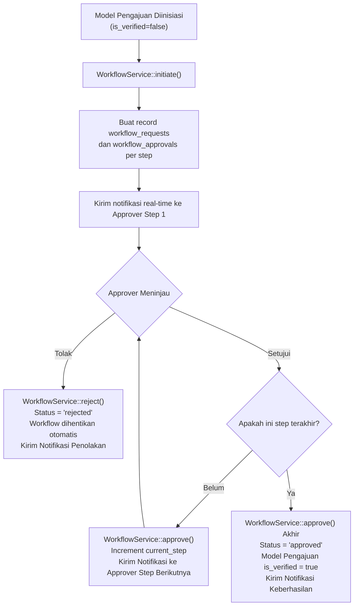

# 🏗️ Arsitektur & Pola Desain Sistem SISTA

Dokumen ini menjelaskan struktur arsitektural kelas dunia yang diimplementasikan pada **SISTA** untuk memastikan performa tinggi, skalabilitas, serta keamanan data mutlak.

---

## 🗂️ 1. Pola Desain Utama (Design Patterns)

SISTA memisahkan tanggung jawab kode secara modular menggunakan pola desain modern:

```
[ HTTP Request ] ──> [ Controller ] ──> [ Policy / Gate ]
                               │
                               ▼ (Delegate complex rules)
                        [ Service Class ] ──> [ Database Transaction ]
                               │
                               ▼ (Data manipulation)
                        [ Eloquent Model ] ──> [ Database File ]
```

### A. Service Pattern
Untuk menghindari *fat controllers* dan menjaga prinsip *Single Responsibility Principle* (SRP), logika bisnis yang kompleks diisolasi ke dalam **Service Class** khusus di bawah `app/Services/`. 
*   **Contoh:** `SmartAlertService` (analitik prediktif), `WorkflowService` (approval engine), `SecurityMonitorService` (SIEM logs), dan `ReportBuilderService` (penyusun query ad-hoc).

### B. Polymorphic Workflows
Approval engine menggunakan relasi polimorfik Eloquent (`MorphTo`) agar tabel `workflow_requests` dapat mengikat model data apa pun (`LeaveRequest`, `Letter`, atau `Syllabus`) tanpa perlu membuat skema tabel persetujuan tersendiri untuk setiap fitur baru.

---

## 📋 2. Diagram Alur Digital Approval Workflow Engine

Approval engine memproses pengajuan dokumen berjenjang secara berurutan berdasarkan *role-path* yang dinamis:



---

## 🛠️ 3. Komunikasi Real-Time (Laravel Reverb WebSocket)

SISTA menggunakan WebSocket server bawaan **Laravel Reverb** untuk mentransmisikan sinyal secara instan dari server ke client tanpa pooling HTTP berkala:
*   **Echo Client:** resource frontend mengimpor `laravel-echo` dan `pusher-js` untuk mendengarkan (*listen*) channel WebSocket.
*   **Channel Keamanan:** `PrivateChannel('user.{id}')` mengamankan notifikasi in-app agar hanya diterima oleh pengguna yang berhak.
*   **Proctoring Monitor:** Channel `chat.*` dan channel ujian real-time memfasilitasi pengawasan langsung aktivitas siswa oleh pengawas.