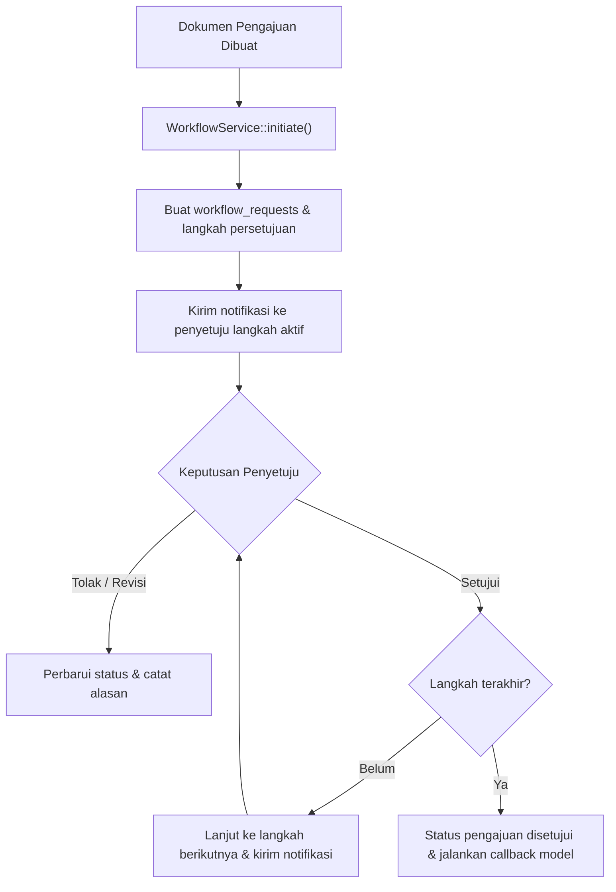

# Arsitektur Sistem SISTA

Dokumen ini menjelaskan struktur arsitektur aplikasi **SISTA (`sistem-terpadu`)**, pola desain utama, mekanisme kontrol akses, mesin alur persetujuan, dan komunikasi waktu nyata.

---

## 1. Pola Desain Utama

Aplikasi memisahkan tanggung jawab antara lapisan HTTP, otorisasi, logika bisnis, dan persistensi data:

```
[ HTTP Request ] ──> [ Middleware (auth, role:, SetLocale) ]
                            │
                            ▼
                     [ Controller ] ──> [ Policy / StudentDataAccess ]
                            │
                            ▼
                     [ Service Class ] ──> [ Database Transaction ]
                            │
                            ▼
                     [ Eloquent Model ] ──> [ Database ]
```

### A. Lapisan Service (`app/Services/`)
Logika bisnis lintas tabel diisolasi di dalam kelas Service di bawah `app/Services/` agar dapat digunakan kembali oleh controller web maupun controller API (`/api/v1`). Contoh implementasi utama:
- `ClassSessionService`: Pengelolaan sesi kelas harian, pembuatan token QR berputar, pencatatan presensi siswa per mata pelajaran, dan rekap kehadiran harian.
- `WorkflowService`: Mesin persetujuan dokumen berjenjang polimorfik.
- `PayrollService` & `EmployeeAttendanceRecap`: Perhitungan penggajian berdasarkan rekap log mesin sidik jari dan cuti pegawai yang disetujui.
- `CbtService` & `CbtScoringService`: Pembuatan sesi ujian teracak deterministik per siswa dan perhitungan nilai otomatis.
- `DapodikService` & `EmisService`: Validasi kelengkapan identitas dan ekspor data ke format Dapodik serta EMIS.

### B. Kontrol Akses Terpusat (`app/Support/Access/`)
- `RoleMiddleware` & `Roles`: Memvalidasi peran pengguna pada route web dan API. Hanya `superadmin` yang melewati pengecekan secara otomatis.
- `RouteAccess`: Mengevaluasi apakah pengguna berhak membuka suatu route bernama (`@canVisit` pada menu sidebar). Route web ber-`auth` yang tidak memiliki aturan peran tertutup secara bawaan (*fail-closed*), kecuali terdaftar eksplisit di `config/route_access.php`.
- `StudentDataAccess` & Scope Model (`Student::visibleTo`, `Classroom::isVisibleTo`): Membatasi query data agar orang tua hanya melihat anaknya sendiri, guru hanya melihat siswa di kelas yang diajar/diwalikannya pada tahun ajaran aktif, dan siswa hanya melihat datanya sendiri.
- `MobileCapabilities` (`config/mobile_features.php`): Menghasilkan daftar kunci fitur yang diizinkan bagi pengguna saat aplikasi Android memuat konfigurasi sesi.

---

## 2. Mesin Alur Persetujuan (`WorkflowService`)

Persetujuan dokumen berjenjang (seperti pengajuan cuti pegawai, surat keluar, dan silabus) menggunakan relasi polimorfik Eloquent (`MorphTo`) melalui tabel `workflow_definitions`, `workflow_requests`, dan `workflow_approvals`.



---

## 3. Komunikasi Waktu Nyata (Laravel Reverb)

SISTA menggunakan **Laravel Reverb** untuk komunikasi WebSocket antara server, peramban web, dan aplikasi Android:
- **Obrolan Wali Murid & Wali Kelas:** Mengirimkan pesan secara langsung pada kanal percakapan privat.
- **Notifikasi In-App:** Mengirimkan pembaruan notifikasi ke kanal privat `user.{id}`.
- **Pemantauan Ujian CBT:** Memperbarui status peserta ujian dan peringatan pelanggaran secara langsung pada layar pengawas.