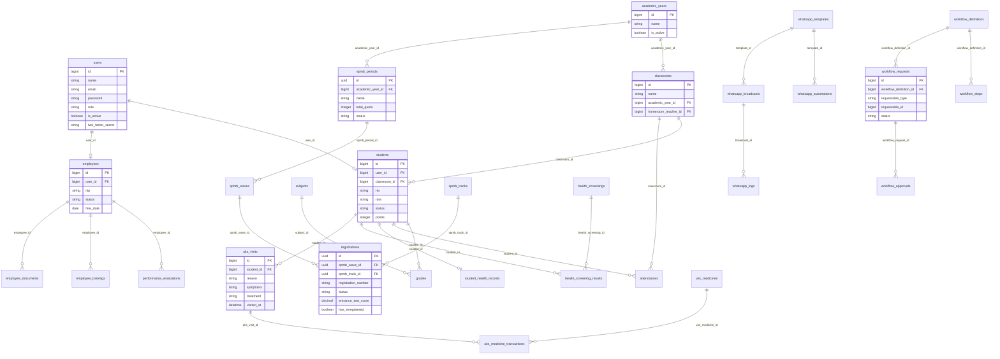

# 🗄️ Dokumentasi Skema Database SISTA

Dokumen ini menjelaskan struktur database **SISTA (Sistem Terpadu SMA Islam Sultan Agung 1 Semarang)** yang berjalan secara default menggunakan SQLite (lokal/pengembangan) dan siap digunakan untuk MySQL/PostgreSQL pada lingkungan produksi.

---

## 🗺️ 1. Entity-Relationship Diagram (ERD) - Mermaid

Mermaid diagram di bawah ini mengilustrasikan tabel-tabel utama di dalam SISTA beserta relasi antarentitasnya:

---

## 🗂️ 2. Kamus Data & Penjelasan Tabel Inti

### A. Inti Identitas & Akses Pengguna (RBAC)
- **`users`**: Tabel sentral otentikasi. Kolom `role` mengontrol perizinan peran (`superadmin`, `admin`, `kepala_sekolah`, `waka_kurikulum`, `waka_kesiswaan`, `guru`, `staf_tu`, `bk`, `student`, `parent`). Mendukung pengamanan sesi ganda via kolom `two_factor_secret` dan `two_factor_confirmed_at`.
- **`students`**: Tabel data akademis siswa yang berelasi *one-to-one* dengan tabel `users`. Menyimpan poin akumulasi pelanggaran konseling BK (`points`) dan relasi kelas aktif (`classroom_id`).
- **`employees`**: Tabel data kepegawaian untuk guru dan staf tata usaha, berelasi *one-to-one* dengan `users`. Menyimpan NIP, status kepegawaian (PNS/Honorer), tanggal masuk, dan informasi penggajian.

### B. Akademik & Evaluasi
- **`classrooms`**: Tabel kelas virtual (misal: X-MIPA-1) yang terikat dengan suatu tahun ajaran (`academic_year_id`) dan diawasi oleh wali kelas (`homeroom_teacher_id` berelasi ke `users`).
- **`grades`**: Tabel nilai tugas, kuis, UTS, dan UAS. Berelasi ke siswa, mata pelajaran (`subjects`), guru penilai, dan tahun ajaran akademik.
- **`attendances`**: Tabel absensi harian siswa (Hadir, Sakit, Izin, Alpa) per kelas.

### C. SPMB Online (Penerimaan Murid Baru)
- **`spmb_periods`**: Periode SPMB (misal: "SPMB 2026/2027") yang terikat ke tahun ajaran aktif.
- **`spmb_waves`**: Gelombang pendaftaran (Gelombang 1, Gelombang 2) yang memilik tanggal mulai, tanggal selesai, kuota pendaftaran, dan biaya registrasi.
- **`spmb_tracks`**: Jalur seleksi masuk (Reguler, Prestasi, Afiliasi).
- **`registrations`**: Data pengajuan registrasi calon siswa (Nomor pendaftaran, berkas digital, nilai ujian masuk CBT, status kelulusan, dan konfirmasi daftar ulang).

### D. HRD & Kepegawaian
- **`performance_evaluations`**: Lembar evaluasi kinerja bulanan/semester untuk pegawai (guru/staf) oleh Kepala Sekolah.
- **`employee_trainings`**: Log partisipasi pelatihan kurikulum (spt. Pelatihan Kurikulum Merdeka) lengkap dengan nomor sertifikat.
- **`employee_documents`**: Arsip berkas administrasi digital pegawai (KTP, Ijazah, SK Kepegawaian, dll.) beserta masa kedaluwarsa dokumen.

### E. UKS & Rekam Medis
- **`student_health_records`**: Catatan riwayat kesehatan dasar siswa (golongan darah, berat/tinggi badan, riwayat alergi, penyakit kronis, dan nomor darurat orang tua).
- **`health_screenings`**: Kegiatan screening kesehatan massal berkala tahunan.
- **`health_screening_results`**: Hasil screening mata (visus), pendengaran, dan gigi per siswa.
- **`uks_visits`**: Log harian siswa yang berobat ke ruang UKS.
- **`uks_medicines`**: Stok obat-obatan yang dikelola UKS.
- **`uks_medicine_transactions`**: Pencatatan pengurangan stok obat otomatis yang terikat pada log tindakan pengobatan `uks_visits`.

### F. WhatsApp Gateway & Notifikasi
- **`whatsapp_templates`**: Daftar template pesan WhatsApp dinamis terdaftar dengan placeholder otomatis (seperti `{nama_siswa}`, `{tagihan}`, dll.).
- **`whatsapp_automations`**: Aturan otomatis yang mengikat event sistem (misal: tagihan diterbitkan) dengan template pesan WA tertentu.
- **`whatsapp_broadcasts`**: Log pengiriman pesan massal terjadwal (broadcast).
- **`whatsapp_logs`**: Catatan status pengiriman real-time (sent/failed) dari WhatsApp Gateway.

### G. Polymorphic Approval Workflow Engine
- **`workflow_definitions`**: Definisi alur persetujuan dokumen (nama alur, kode unik).
- **`workflow_steps`**: Langkah-langkah persetujuan berurutan (misal: Step 1 disetujui Waka, Step 2 disetujui Kepala Sekolah) beserta batas waktu pengerjaan SLA (dalam jam).
- **`workflow_requests`**: Pengajuan persetujuan aktif. Kolom `requestable_type` dan `requestable_id` berelasi secara polimorfik ke model dokumen pengajuan (Cuti Pegawai, Silabus, Surat Keluar).
- **`workflow_approvals`**: Log status tinjauan (Approve/Reject/Revision) dari masing-masing approver di setiap langkah persetujuan.

---

*Dokumen ini diperbarui secara berkala mengikuti perkembangan migrasi skema database SISTA.*
