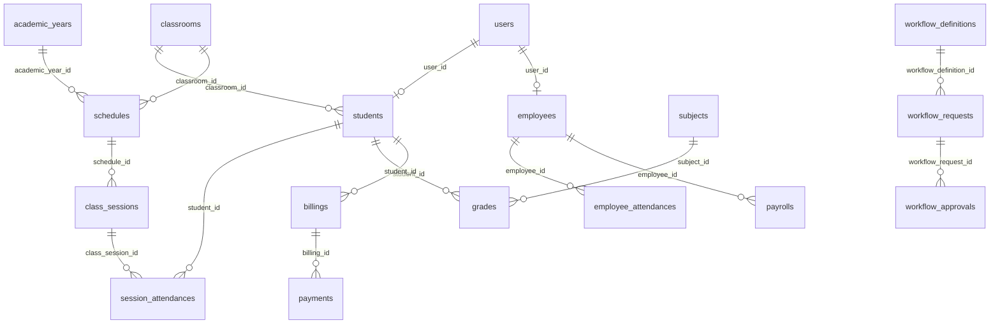

# Dokumentasi Skema Database SISTA

Dokumen ini menjelaskan struktur tabel inti pada database **SISTA (Sistem Terpadu SMA Islam Sultan Agung 1 Semarang)**. Sistem menggunakan SQLite untuk pengembangan/pengujian lokal dan mendukung MySQL maupun PostgreSQL pada lingkungan produksi.

---

## 1. Diagram Relasi Entitas (ERD Inti)

---

## 2. Kelompok Tabel Utama

### A. Identitas & Hak Akses
- `users`: Data akun pengguna (`name`, `email`, `password`, `role`, `preferred_locale`, `two_factor_secret`).
- `students`: Profil akademik siswa (`user_id`, `classroom_id`, `nis`, `nisn`, `gender`, `birth_place`, `birth_date`, `mother_name`, `status`).
- `employees`: Data guru dan staf kependidikan (`user_id`, `nip`, `nuptk`, `fingerprint_id`, `position`, `status`, `base_salary`).
- `student_parent`: Tabel pivot relasi antara akun orang tua (`users`) dan siswa (`students`).

### B. Akademik, Sesi Kelas & Evaluasi
- `academic_years`: Tahun ajaran dan semester (`year`, `semester`, `is_active`).
- `classrooms`: Rombongan belajar (`name`, `grade_level`, `academic_year`, `homeroom_teacher_id`).
- `subjects`: Mata pelajaran (`code`, `name`, `category`, `kkm`).
- `schedules`: Jadwal pelajaran per kelas, mata pelajaran, guru, hari, dan jam.
- `class_sessions` & `session_attendances`: Sesi kelas harian yang dibuka guru beserta presensi QR siswa per mata pelajaran (`hadir`, `telat`, `izin`, `sakit`, `alpa`).
- `teaching_journals`: Jurnal mengajar guru per pertemuan.
- `daily_assessments` & `daily_assessment_scores`: Penilaian harian dan nilai per siswa.
- `grades` & `report_cards`: Nilai akademik semester, capaian kompetensi, dan rapor P5.
- `exams`, `question_banks`, `questions`, `exam_attempts`: Bank soal dan pelaksanaan ujian berbasis komputer (CBT).

### C. Kesiswaan, BK, UKS & Keislaman
- `counseling_sessions`: Catatan sesi konseling siswa (kolom sensitif disimpan terenkripsi).
- `bullying_reports`: Laporan perundungan siswa/orang tua untuk penanganan TPPK.
- `iep_documents`, `screening_results`, `accommodation_registries`, `differentiated_plans`: Pendampingan pendidikan inklusi.
- `point_categories` & `student_points`: Pencatatan poin kedisiplinan dan pelanggaran.
- `uks_visits`, `uks_medicines`, `student_health_records`: Rekam kunjungan UKS dan stok obat.
- `tahfidz_records`, `mutabaah_logs`, `tahsin_submissions`: Pencatatan setoran hafalan Al-Qur'an, ibadah harian, dan evaluasi bacaan Tahsin.

### D. Keuangan & Perbendaharaan
- `billings` & `payments`: Tagihan siswa (SPP, uang pangkal) dan transaksi pembayaran (Midtrans VA maupun tunai).
- `scholarships` & `scholarship_recipients`: Program beasiswa dan potongan biaya siswa.
- `bank_accounts`, `bank_transactions`, `petty_cash_funds`, `petty_cash_transactions`, `vendor_payments`: Pengelolaan kas kecil, rekening bank, dan rekonsiliasi.
- `accounts`, `journal_entries`, `journal_entry_lines`, `budget_plans`: Bagan akun standar, jurnal umum berpasangan, dan perencanaan anggaran (RKAS).

### E. Kepegawaian (HRD)
- `employee_attendances`: Kehadiran harian guru dan karyawan hasil impor mesin sidik jari.
- `leave_requests`: Permohonan izin/cuti pegawai yang terhubung dengan `WorkflowService`.
- `payrolls`: Slip penggajian bulanan berdasarkan gaji pokok, tunjangan, dan rekap kehadiran (`EmployeeAttendanceRecap`).
- `evaluation_360_cycles` & `teacher_evaluations`: Evaluasi kinerja guru oleh siswa dan rekan sejawat/pimpinan.

### F. Administrasi, Sarpras & Alur Kerja
- `spmb_periods`, `spmb_waves`, `spmb_tracks`, `registrations`: Penerimaan murid baru (SPMB) dan konversi menjadi data siswa.
- `assets`, `asset_categories`, `asset_loans`, `asset_maintenances`, `asset_maintenance_tickets`, `rooms`: Inventaris sarana prasarana, peminjaman, dan tiket perbaikan aset.
- `workflow_definitions`, `workflow_requests`, `workflow_approvals`: Mesin persetujuan berjenjang polimorfik.
