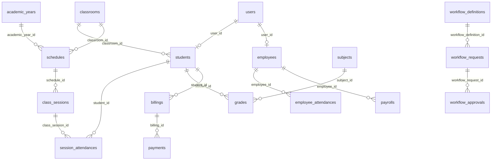

# Dokumentasi Skema Database SISTA

Dokumen ini menjelaskan struktur tabel inti pada database **SISTA (Sistem Terpadu SMA Islam Sultan Agung 1 Semarang)**. Sistem menggunakan SQLite untuk pengembangan/pengujian lokal dan mendukung MySQL maupun PostgreSQL pada lingkungan produksi.

---

## 1. Diagram Relasi Entitas (ERD Inti)

---

## 2. Kelompok Tabel Utama

### A. Identitas, Jabatan & Hak Akses
- `users`: Data akun pengguna (`name`, `email`, `password`, `role`, `account_type`, `account_status`, `must_change_password`, `preferred_locale`, `two_factor_secret`).
- `positions`, `position_permissions`, `position_assignments`: Katalog jabatan dinamis, pemetaan izin per modul, serta penetapan pejabat aktif maupun Plt per periode SK (`L1`–`L2`).
- `students`: Profil akademik siswa (`user_id`, `parent_id`, `classroom_id`, `nis`, `nisn`, `gender`, `birth_place`, `birth_date`, `mother_name`, `status`).
- `employees`: Data guru dan staf kependidikan (`user_id`, `nip`, `nuptk`, `fingerprint_id`, `position`, `status`, `base_salary`).
- `profile_change_requests`: Pengajuan perubahan data identitas resmi beserta bukti dokumen privat dan status sinkronisasi Dapodik (`K4`).

### B. Siklus Akademik, Sesi Kelas, e-Rapor & Projek P5
- `school_years`, `academic_calendars`, `academic_calendar_events`, `academic_years`: Siklus tahun ajaran kanonik, kalender akademik berjenjang, dan semester aktif (`A0`–`A1`).
- `classrooms`, `class_enrollments`, `promotion_batches`, `promotion_decisions`, `graduation_batches`, `graduation_decisions`, `student_mutations`, `alumni_data`: Rombongan belajar, riwayat penempatan siswa lintas tahun ajaran, kenaikan kelas (`A4`), kelulusan massal kelas XII (`A5`), dan mutasi masuk/keluar (`A6`).
- `elective_surveys`, `elective_choices`, `grade_xi_room_plans`, `class_placements`: Survei peminatan kelas X dan perancangan serta plotting rombel kelas XI (`A3`).
- `subjects` & `schedules`: Mata pelajaran dan jadwal mengajar per kelas, guru, hari, dan jam (`C1`).
- `class_sessions`, `session_attendances`, `student_leave_requests`: Sesi kelas harian ber-QR 30 detik (`C2`) serta izin/sakit siswa dari orang tua (`C3`).
- `teaching_journals`, `daily_assessments`, `daily_assessment_scores`: Jurnal mengajar (`C4`) dan penilaian harian/remedial (`D1`).
- `grades`, `report_cards`, `erapor_export_batches`, `official_report_publications`: Nilai semester, ekspor template e-Rapor resmi, dan penerbitan PDF rapor semester (`D5`).
- `p5_projects`, `p5_project_dimensions`, `p5_project_facilitators`, `p5_project_assessments`, `p5_project_student_notes`: Projek Penguatan Profil Pelajar Pancasila (`D4`) dengan predikat resmi `MB`/`SB`/`BSH`/`SAB` dan Rapor Projek P5 terpisah.
- `exams`, `question_banks`, `questions`, `exam_attempts`: Bank soal dan pelaksanaan ujian berbasis komputer (`D2`).

### C. Kesiswaan, BK, UKS & Keislaman
- `counseling_sessions`: Catatan sesi konseling siswa (kolom sensitif disimpan terenkripsi, termasuk konseling wajib tahapan SP).
- `bullying_reports`: Laporan perundungan siswa/orang tua untuk penanganan TPPK (`E3`).
- `iep_documents`, `screening_results`, `accommodation_registries`, `differentiated_plans`: Pendampingan pendidikan inklusi (`E4`).
- `point_categories`, `student_point_logs`, `warning_letters`: Pencatatan poin kedisiplinan dan penerbitan Surat Peringatan bertingkat (`SP1`/`SP2`/`SP3`) berbasis ambang dinamis sekolah (`E1`).
- `uks_visits`, `uks_medicines`, `student_health_records`: Rekam kunjungan UKS dan stok obat (`E5`).
- `tahfidz_logs`, `mutabaah_logs`, `tahsin_logs`: Pencatatan setoran hafalan Al-Qur'an, ibadah harian, dan evaluasi bacaan Tahsin (`F1`–`F3`).

### D. Keuangan & Perbendaharaan
- `billings` & `payments`: Tagihan siswa (SPP, uang pangkal) dan transaksi pembayaran (`G1`).
- `scholarships` & `scholarship_recipients`: Program beasiswa dan potongan biaya siswa (`G2`).
- `bank_accounts`, `bank_transactions`, `petty_cash_funds`, `petty_cash_transactions`, `vendor_payments`: Pengelolaan kas kecil, rekening bank, pembayaran vendor, dan rekonsiliasi (`G3`–`G4`, `G7`).
- `accounts`, `journal_entries`, `journal_entry_lines`, `budget_plans`: Bagan akun standar, jurnal umum berpasangan, dan perencanaan anggaran RKAS (`G5`).

### E. Kepegawaian (HRD)
- `employee_attendances`: Kehadiran harian guru dan karyawan hasil impor mesin sidik jari (`H1`).
- `leave_requests`: Permohonan izin/cuti pegawai yang terhubung dengan `WorkflowService` (`H2`).
- `payrolls`: Slip penggajian bulanan berdasarkan gaji pokok, tunjangan, dan rekap kehadiran (`H3`).
- `evaluation_360_cycles` & `teacher_evaluations`: Evaluasi kinerja guru (`H4`).

### F. Administrasi, Persuratan, Sarpras & Alur Kerja
- `spmb_periods`, `spmb_waves`, `spmb_tracks`, `registrations`: Penerimaan murid baru (SPMB) dan konversi menjadi data siswa (`B1`).
- `letter_templates`, `letters`, `incoming_letters`, `letter_dispositions`: Surat keluar resmi ber-QR verifikasi (`J1`) serta surat masuk dan disposisi pimpinan (`J2`).
- `assets`, `asset_categories`, `asset_loans`, `asset_maintenances`, `asset_maintenance_tickets`, `rooms`: Inventaris sarana prasarana, peminjaman, jadwal perawatan, dan tiket laporan kerusakan berbasis QR (`I1`–`I4`).
- `workflow_definitions`, `workflow_requests`, `workflow_approvals`: Mesin persetujuan berjenjang polimorfik lengkap dengan tenggat SLA (`due_at`), delegasi, pengingat, dan eskalasi otomatis.
