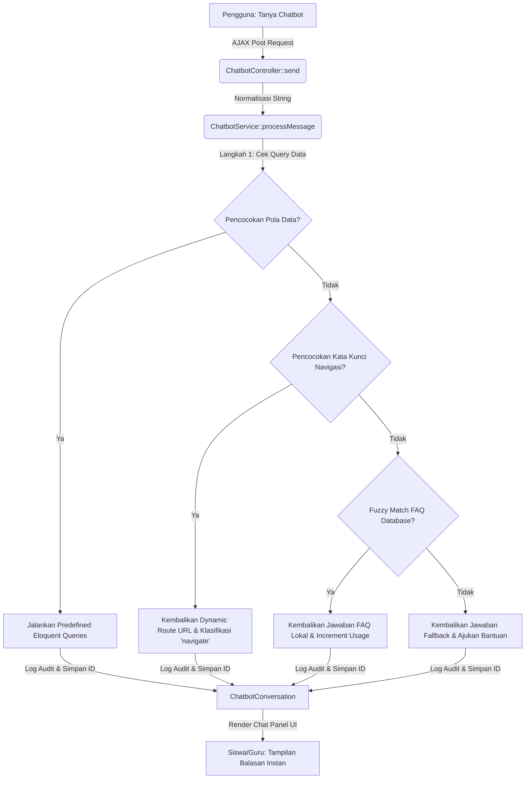

# 🤖 Modul AI Assistant Chatbot Sekolah (Lokal) SISTA

Modul AI Assistant Chatbot SISTA bertindak sebagai asisten sekolah pintar terintegrasi (*smart virtual concierge*) yang membantu civitas akademika (siswa, guru, wali murid) dalam menjelajahi platform, mengakses data operasional harian secara instan, dan menjawab FAQ sekolah tanpa dependensi API berbayar.

---

## 📚 1. Komponen Utama & Database Schema

Penyimpanan bank data dan log aktivitas chatbot dikelola oleh skema tabel berikut:

### A. Tabel Bank FAQ (`ChatbotFaq`)
*   Menyimpan data tanya-jawab sekolah yang dikelola secara terpusat oleh administrator.
*   `question`: Pertanyaan umum pengguna.
*   `answer`: Jawaban detail asisten (mendukung cetak tebal markdown dan link HTML).
*   `category`: Kategori pembahasan (`akademik`, `keuangan`, `teknis`, `umum`).
*   `keywords` (JSON): Kumpulan tag kata kunci untuk meningkatkan pencarian.
*   `usage_count`: Counter akumulasi jumlah FAQ dibaca pengguna.
*   `is_active`: Flag status aktif.

### B. Tabel Log Percakapan (`ChatbotConversation`)
*   Mencatat riwayat audit interaksi pengguna dengan asisten.
*   `user_id`: Relasi ke tabel `users`.
*   `user_message`: Teks masukan pengguna.
*   `bot_response`: Jawaban yang diberikan chatbot.
*   `intent`: Hasil klasifikasi niat (`query_data`, `navigate`, `faq`, `unknown`).
*   `context_data` (JSON): Metadata konteks query atau URL navigasi target.
*   `confidence`: Nilai akurasi klasifikasi (float).
*   `was_helpful`: Feedback dari pengguna (thumbs up/down).

---

## ⚙️ 2. Arsitektur Pemrosesan Lokal Bebas Biaya (Local Intent Engine)

Chatbot SISTA dirancang 100% mandiri (*self-hosted ready*), aman dari kebocoran data keluar sekolah, dan bebas dari biaya token API LLM bulanan:

### A. Penerjemah Niat Query Data Aman (Predefined Data Translator):
Untuk melayani pertanyaan statistik operasional sekolah secara instan, sistem memotong string masukan pengguna dan mencocokkannya ke query Eloquent teroptimasi tanpa risiko SQL Injection:
1.  *"alpa hari ini"* &rarr; Memanggil `Attendance::where('date', today())->where('status', 'A')->count()`
2.  *"tunggakan spp"* &rarr; Memanggil `Billing::where('remaining_balance', '>', 0)->count()`
3.  *"siswa aktif"* &rarr; Memanggil `Student::where('status', 'active')->count()`
4.  *"tiket open"* &rarr; Memanggil `Ticket::where('status', 'open')->count()`
5.  *"belum jurnal hari ini"* &rarr; Menghitung selisih jumlah total guru dengan guru yang sudah mengisi `TeachingJournal` hari ini.

### B. Fuzzy Navigation & Local FAQ Engine:
*   **Fuzzy Navigation:** Menyediakan pencarian sinonim dinamis (seperti *absen*, *kehadiran*, *presensi*) yang secara otomatis memunculkan link interaktif menuju route internal SISTA yang relevan (seperti `/attendances`).
*   **Local FAQ Matcher:** Menghitung jumlah bobot kemunculan kata kunci (*keyword hits weight*) pada bank tanya-jawab lokal. Sistem memberikan poin kecocokan tinggi (poin +5) jika pesan mengandung pertanyaan persis, dan (poin +2) untuk setiap tag kata kunci yang beririsan.

---

## 📝 3. Pest Feature Test Scenarios

Logika parsing pencarian, validasi rates, database transactions, dan feedback loops divalidasi oleh Pest PHP pada [ChatbotTest.php](file:///c:/project/portofolio/project-super-web/sistem-terpadu/tests/Feature/ChatbotTest.php):

*   **`unauthenticated users are blocked from sending chatbot messages`**
    *   Memastikan pengguna tamu tanpa login diblokir dengan respons `401 Unauthorized`.
*   **`authenticated users can send message and receive chatbot response`**
    *   Menguji pencocokan FAQ lokal dan memastikan log percakapan tersimpan dengan status `faq` serta confidence level yang sesuai.
*   **`navigation keywords are automatically parsed into target urls`**
    *   Memasukkan kata kunci seperti "absensi" dan memverifikasi tautan `/attendances` terender pada respons JSON.
*   **`natural language queries are resolved into eloquent counts`**
    *   Memastikan pencarian data riil (seperti jumlah total siswa aktif) mengembalikan angka agregat tepercaya dari database.
*   **`users can submit helpful feedback on chatbot conversation`**
    *   Memverifikasi toggle jempol ke atas/ke bawah terupdate secara presisi pada kolom `was_helpful` di tabel database log.
*   **`admin can manage chatbot FAQs CRUD operations successfully`**
    *   Menguji keandalan operasi Create, Read, Update, dan Delete data FAQ oleh peran `admin` serta pembatasan akses untuk peran non-admin.
