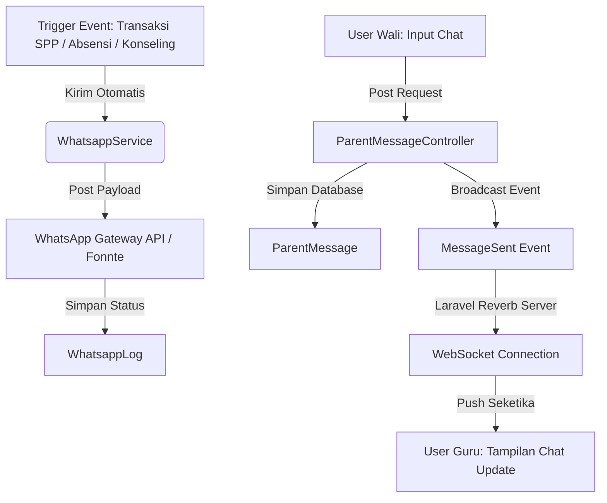

# Modul WhatsApp Gateway & Chat Real-Time SISTA

Modul Komunikasi SISTA dirancang untuk menjembatani komunikasi interaktif, instan, dan real-time antara seluruh ekosistem sekolah: pihak sekolah (admin/guru), orang tua/wali siswa, dan siswa itu sendiri.

---

## 1. Komponen Utama & Database Schema

### A. WhatsApp Notification Gateway
*   **`WhatsappLog`**: Mencatat log riwayat pengiriman pesan WA, nomor tujuan, isi pesan, status pengiriman (`sent`, `failed`), dan response payload dari API gateway (Fonnte).
*   **`WhatsappService`**: Kelas service pusat untuk memicu pengiriman pesan WA secara transaksional maupun broadcast massal.

### B. Parent-Teacher Real-Time Chat Hub
*   **`ParentMessage`**: Menyimpan log obrolan pesan teks dan lampiran file/gambar antara wali murid (`User` dengan peran `wali`) dengan guru/wali kelas (`User` dengan peran `guru`).
*   **`MessageSent` (Broadcast Event)**: Dipicu ketika ada pesan baru untuk disalurkan secara instan ke browser penerima via **Laravel Reverb**.

---

## 2. Alur Pesan Real-Time & WhatsApp Gateway

Modul komunikasi mengombinasikan polling transaksional (WhatsApp) dengan penyaluran real-time interaktif (WebSocket):

### A. Fitur WhatsApp Gateway:
1.  **Notifikasi SPP Otomatis:** Mengirimkan pengingat penagihan SPP bulanan langsung ke nomor HP orang tua pada tanggal tertentu beserta nominal tagihan unik.
2.  **Notifikasi Kehadiran Seketika:** Sistem absensi digital yang terhubung dengan GPS memicu pesan WhatsApp otomatis kepada wali jika anak dinyatakan alpa (`A`) atau terlambat mengajar.
3.  **Alert Bimbingan Konseling (BK):** Mengirimkan ringkasan sanksi perilaku siswa kepada wali murid saat bimbingan konseling diinput.

### B. Real-Time Chat Hub (Wali-Guru):
1.  **Dynamic Chat Channels:** Saluran komunikasi privat terenkripsi. Orang tua hanya bisa memulai obrolan dengan wali kelas anak mereka atau guru BK sekolah.
2.  **Live Visual Indicators:** Menampilkan indikator ketik (*typing indicators*) dan status pesan terbaca (*read receipts*) menggunakan Alpine.js dan Laravel Echo.

---

## 3. Pest Feature Test Scenarios

Sistem notifikasi multi-channel dan alur pesan divalidasi oleh Pest PHP:

### A. WhatsApp & Notification Tests (`MultiChannelNotificationTest.php`)
*   **`sistem memicu notifikasi otomatis saat tagihan dibuat`**
    *   Memastikan saat billing SPP baru terbit, event dipicu untuk mengirim pesan WhatsApp ke wali murid dan mencatatnya ke `whatsapp_logs`.
*   **`sistem mencatat log kegagalan jika gateway offline`**
    *   Mensimulasikan respons error API dari gateway Fonnte dan memverifikasi log WA tersimpan dengan status `failed` beserta payload error-nya.

### B. Real-Time Chat Tests (`RealTimeEventTest.php`)
*   **`pesan obrolan wali-guru terkirim dan membroadcast event`**
    *   Menguji bahwa pengiriman pesan privat memicu event `MessageSent` ke channel WebSocket yang tepat.
