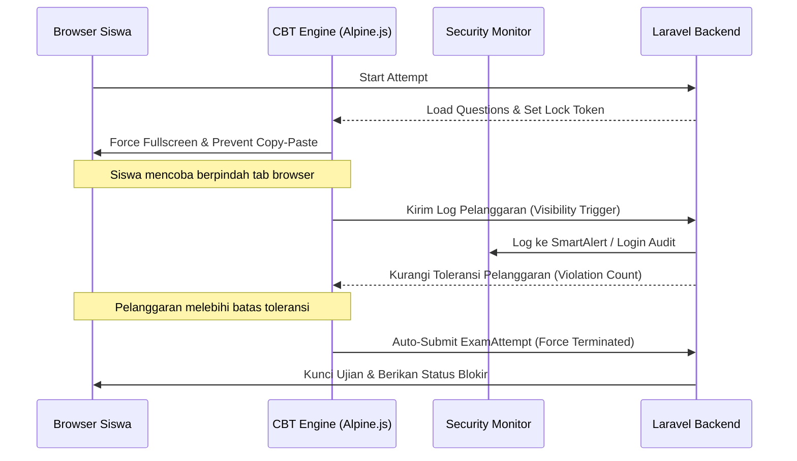

# Modul E-Learning & Secure CBT SISTA

Modul E-Learning dan Computer-Based Test (CBT) SISTA dirancang untuk memfasilitasi kegiatan belajar-mengajar digital yang efisien, terstruktur, serta pelaksanaan ujian online dengan integritas tinggi yang dilindungi oleh berbagai sistem keamanan pencegahan kecurangan (*cheat prevention*).

---

## 1. Komponen Utama & Database Schema

### A. E-Learning Classroom & Materials
*   **`ElearningClass`**: Menghubungkan kelas fisik (`Classroom`) dengan guru pengampu, mata pelajaran (`Subject`), dan topik belajar.
*   **`ElearningMaterial`**: Dokumen/materi pelajaran (PDF, video, link eksternal) yang diunggah oleh guru untuk kelas tertentu.
*   **`ElearningAssignment`**: Tugas digital ber-deadline dengan parameter bobot nilai.
*   **`ElearningSubmission`**: Pengajuan tugas dari siswa berisi catatan, file lampiran, dan metadata penyerahan.

### B. Secure CBT (Computer-Based Test) System
*   **`QuestionBank`**: Bank soal yang menyimpan bank pertanyaan (pilihan ganda/esai), opsi jawaban terenkripsi, kunci jawaban, dan alokasi poin per soal.
*   **`Exam`**: Definisi ujian online dengan parameter: waktu mulai, durasi (menit), batas toleransi pelanggaran (*violation tolerance*), pengacakan soal (*randomized questions*), serta opsi browser lock.
*   **`ExamAttempt`**: Sesi pengerjaan ujian aktif siswa yang melacak status mulai, sisa waktu, jumlah pelanggaran, log kecurigaan, status selesai, dan skor akhir otomatis.

---

## 2. Sistem Proteksi CBT (Anti-Cheat Security Framework)

Untuk menjamin kejujuran ujian online, sistem CBT SISTA mengintegrasikan lapis pengawasan sisi klien (*client-side*) menggunakan Alpine.js dan deteksi perilaku mencurigakan:

### A. Fitur Anti-Kecurangan Utama:
1.  **Fullscreen Blocker:** Siswa dipaksa berada pada mode layar penuh. Jika keluar dari layar penuh, sistem memicu peringatan seketika.
2.  **Visibility Tab Tracking:** Mendeteksi jika siswa berpindah tab browser atau meminimalkan window browser menggunakan Page Visibility API. Setiap perpindahan tab langsung tercatat sebagai 1 kali pelanggaran (*violation*).
3.  **Copy-Paste Disabled:** Mencegah pintasan keyboard `Ctrl+C`, `Ctrl+V`, `Ctrl+X`, klik kanan mouse, dan text selection pada halaman ujian.
4.  **Mobile Vibration & Alert System:** Pada perangkat seluler, sensor getar dipicu untuk memberikan peringatan fisik taktil jika siswa mencoba berpindah fokus layar.
5.  **Auto-Submit Force Trigger:** Jika counter pelanggaran siswa melebihi batas toleransi yang ditentukan oleh guru pada konfigurasi ujian, sesi ujian langsung dihentikan paksa (*terminated*) dan jawaban terakhir otomatis dikunci dan dinilai.

---

## 3. Pest Feature Test Scenarios

Kestabilan dan kepatuhan sistem keamanan CBT dipastikan oleh suite pengujian otomatis pada [CbtSecurityTest.php](file:///c:/project/portofolio/project-super-web/sistem-terpadu/tests/Feature/Cbt/CbtSecurityTest.php):

*   **`siswa dapat memulai pengerjaan ujian`**
    *   Memastikan siswa aktif dapat membuka token pengerjaan baru dan membuat record baru pada tabel `exam_attempts` dengan status `in_progress`.
*   **`sistem mencatat pelanggaran tab visibility secara real-time`**
    *   Mensimulasikan request AJAX perpindahan fokus tab dan memverifikasi kolom `violation_count` pada `ExamAttempt` bertambah.
*   **`sistem melakukan auto-submit jika melampaui toleransi pelanggaran`**
    *   Mengirimkan pelanggaran berturut-turut hingga melampaui batas maksimum toleransi dan memverifikasi status pengerjaan berubah menjadi `submitted` secara otomatis serta akses ke soal ujian ditutup rapat.
*   **`siswa tidak dapat mengakses halaman ujian setelah disubmit`**
    *   Memastikan route pengerjaan ujian melempar respons `403 Forbidden` apabila status attempt sudah `completed` atau `submitted`.
