# 📥 Modul Universal Data Import/Export Hub SISTA

Universal Import/Export Hub SISTA dirancang untuk memberikan kemudahan bagi administrator TU dan operator sekolah dalam melakukan migrasi data massal (bulk import) secara aman dari berkas Excel/CSV ke database platform, serta penarikan laporan dinamis dalam berbagai format.

---

## 📚 1. Komponen Utama & Database Schema

### A. Model Log Impor (`ImportLog`)
*   **`ImportLog`**: Menyimpan metadata penting sesi impor.
    *   `module`: Nama modul sasaran (contoh: `'students'`, `'employees'`, `'grades'`).
    *   `imported_by`: ID User yang mengeksekusi operasi.
    *   `file_name`: Nama berkas sumber.
    *   `total_rows`, `success_count`, `error_count`: Statistik eksekusi.
    *   `error_details` (JSON): Log kesalahan validasi per baris yang bermasalah.
    *   `created_ids` (JSON): Daftar primary key (`id`) dari record yang berhasil ditambahkan (digunakan sebagai acuan rollback).
    *   `status`: Status sesi (`processing`, `completed`, `failed`, `rolled_back`).

### B. Service Pengolah (`ImportExportService`)
*   **`ImportExportService`**: Pusat logika pemrosesan file Excel/CSV menggunakan library `PhpSpreadsheet`/`Laravel Excel`.

---

## ⚙️ 2. Arsitektur Mapping & Alur Transaksi Aman

Sistem impor SISTA menjamin keandalan data (*data integrity*) dengan menerapkan alur verifikasi berlapis dan mekanisme rollback kaskade:

```mermaid
sequenceDiagram
    participant Admin as Tampilan Hub Impor
    participant Backend as ImportExportService
    participant DB as MySQL/SQLite Database

    Admin->>Backend: Upload File Excel/CSV (Temporary Storage)
    Backend-->>Admin: Kembalikan Preview 5 Baris & Header Berkas
    Note over Admin: Admin melakukan pemetaan kolom visual (Smart Match)
    Admin->>Backend: Execute Import (Mapping & Data Preview)
    
    rect rgb(30, 41, 59)
        Note over Backend,DB: Mulai Transaction Block
        Backend->>Backend: Validasi format & tipe data per baris
        loop Per Baris Data
            Backend->>DB: Insert Record & Simpan ID yang Dibuat
        end
        alt Validasi Berhasil 100%
            Backend->>DB: Commit Transaction
            Backend-->>Admin: Kirim Notifikasi Sukses & Simpan ImportLog
        else Terdapat Error Validasi
            Backend->>DB: Rollback Transaction
            Backend-->>Admin: Tampilkan Panel Diagnostik Error Per Baris
        end
    end
```

### A. Fitur Pemetaan Kolom Cerdas (Smart Mapper):
1.  **Visual Columns Mapping Wizard:** Dropdown interaktif bagi pengguna untuk memilih kolom database tujuan dari setiap kolom berkas Excel yang terdeteksi.
2.  **Case-Insensitive Auto-Match:** Algoritma mencocokkan string header terdekat secara otomatis (contoh: `'Nomor Induk'` atau `'nis'` akan otomatis terpetakan ke kolom database `'nis'`).
3.  **Data Casting:** Mengonversi data mentah otomatis (misal: nomor ponsel diawali `'08'` otomatis ditambahkan kode negara `'+62'`, string `'Laki-Laki'` dikonversi menjadi boolean/enum jenis kelamin `'L'`).

### B. Mekanisme Cascading Rollback:
Jika terdeteksi bahwa berkas yang diimpor salah format atau berisi duplikasi data setelah proses selesai, Admin dapat menekan tombol **Rollback** pada histori impor.
*   Sistem memuat record `ImportLog` dan mengambil `created_ids` dari database.
*   Melakukan penghapusan data secara berantai (*cascading delete*) mulai dari dependensi anak hingga data induk (contoh: hapus record `Student`, hapus biodata `User` yang bersangkutan secara kaskade).
*   Log diupdate menjadi status `rolled_back` secara aman.

---

## 📝 3. Pest Feature Test Scenarios

Logika parsing, validasi, transaksi, dan rollback diuji melalui Pest PHP pada [ImportExportTest.php](file:///c:/project/portofolio/project-super-web/sistem-terpadu/tests/Feature/ImportExportTest.php):

*   **`admin dapat mengunggah file untuk preview visual`**
    *   Memastikan endpoint upload mengembalikan daftar header kolom beserta 5 baris pertama data sampel dari file `.xlsx`/`.csv`.
*   **`eksekusi impor berjalan sukses dengan pemetaan kolom yang valid`**
    *   Membuat pemetaan field database buatan dan mengirimkan post request eksekusi. Memverifikasi data tersimpan secara akurat di database.
*   **`transaksi database dibatalkan apabila terdapat baris data yang cacat`**
    *   Memasukkan data cacat pada baris ke-3 (misal: format email salah). Memverifikasi transaksi di-rollback secara penuh sehingga baris ke-1 dan ke-2 tidak ikut tersimpan ke database.
*   **`tombol rollback menghapus seluruh data yang dibuat sesi impor terkait`**
    *   Memicu aksi rollback pada ID `ImportLog` tertentu dan menegaskan bahwa seluruh record siswa dan akun user terkait pada log tersebut telah bersih dari database tanpa sisa.
