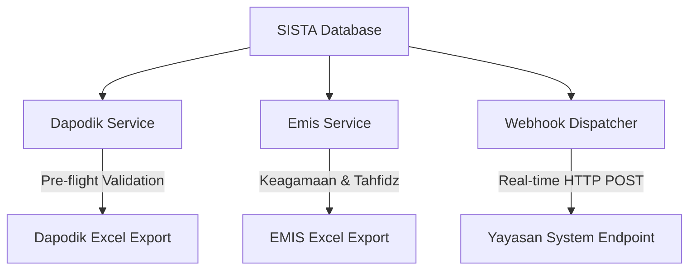

# Dokumen Teknis Modul 2: Integrasi Dapodik & Sistem Pemerintah

Dokumen ini menjelaskan arsitektur, skema data, alur validasi, dan integrasi webhook outgoing yang diimplementasikan pada **SISTA (Sistem Informasi Sekolah Terpadu)** untuk menghubungkan data sekolah dengan sistem pemerintah (**Dapodik Kemendikbud**, **EMIS Kemenag**) serta sistem eksternal **Yayasan Badan Wakaf Sultan Agung**.

---

## 🏗️ 1. Arsitektur Sistem

Modul integrasi ini memadukan ekspor file spreadsheet biner dinamis (.xlsx) untuk pelaporan instan ke instansi pemerintah dengan push notifikasi HTTP real-time (Webhooks) untuk sinkronisasi dengan database yayasan.



---

## 🗃️ 2. Skema Tabel Database

Modul ini memperkenalkan tiga tabel baru pada database SISTA:

### `integration_configs`
Menyimpan konfigurasi kredensial dan pengaturan kustom per provider integrasi.
*   `provider`: `'dapodik'`, `'emis'`, `'yayasan'` (kunci unik).
*   `credentials`: Menyimpan token akses atau kredensial API yang diamankan menggunakan enkripsi internal Laravel (`Crypt::encryptString`).
*   `settings`: Format JSON kustom untuk mapping penyesuaian kolom.

### `integration_logs`
Mencatat seluruh rekam jejak audit ekspor maupun sinkronisasi data.
*   `direction`: `'export'`, `'import'`, `'sync'`.
*   `status`: `'success'` (sukses penuh), `'partial'` (sukses sebagian dengan peringatan), `'failed'` (gagal eksekusi).
*   `error_details`: Menyimpan daftar warning baris data yang kurang lengkap dalam format JSON.

### `webhooks`
Mengelola pendaftaran endpoint webhook outgoing untuk transfer data real-time.
*   `uuid`: Identitas UUID unik yang aman untuk eksposur publik.
*   `url`: URL endpoint tujuan (contoh: `https://yayasan.sch.id/api/sync`).
*   `events`: Menyimpan array event terdaftar (`['student.created', 'billing.paid']`).

---

## 🧑‍🎓 3. Mapping Skema Kolom Ekspor

### A. Format Dapodik Kemendikbud

| Kolom Dapodik | Atribut SISTA | Deskripsi / Fallback |
| :--- | :--- | :--- |
| **NISN** | `student.nisn` | Wajib tepat 10 digit angka |
| **NIS** | `student.nis` | Nomor Induk Sekolah |
| **Nama Lengkap** | `student.user.name` | Wajib diisi |
| **Jenis Kelamin** | `student.gender` | Di-cast menjadi `L` atau `P` |
| **Tempat Lahir** | *Fallback* | Default: `"Semarang"` |
| **Tanggal Lahir** | `student.birth_date` | Format standar: `YYYY-MM-DD` |
| **Alamat** | `student.address` | Alamat tempat tinggal siswa |
| **Rombel Kelas** | `student.classroom.name`| Nama rombongan belajar aktif |
| **Nama Ibu Kandung**| *Fallback* | Default: `"Ibu Kandung Siswa"` |

### B. Format EMIS Kemenag (Keagamaan & Gamifikasi)

| Kolom EMIS | Atribut SISTA | Deskripsi / Fallback |
| :--- | :--- | :--- |
| **NISN** | `student.nisn` | Kunci unik nasional |
| **Nama Lengkap** | `student.user.name` | Identitas siswa |
| **Jenis Kelamin** | `student.gender` | Ditampilkan Laki-laki / Perempuan |
| **Rombel Kelas** | `student.classroom.name`| Rombel aktif |
| **Level Gamifikasi**| `student.level` | Diambil dari level gamifikasi aktif SISTA |
| **Total XP** | `student.total_xp` | Akumulasi XP keaktifan siswa |
| **Capaian Tahfidz** | `student.tahfidzLogs` | Akumulasi total Juz yang disetorkan |
| **Status Keagamaan**| `student.status` | Kategori keaktifan ibadah harian siswa |

---

## ⚠️ 4. Pra-Validasi Validasi Kelayakan (*Pre-flight Check*)

Untuk mencegah penolakan impor data pada sistem Dapodik pusat, `DapodikService` dilengkapi dengan aturan pra-validasi sebelum proses unduh berkas dijalankan:

1.  **NISN Format Check**: Sistem memverifikasi bahwa NISN tidak boleh kosong dan harus berupa deretan angka yang tepat berjumlah 10 digit. Jika melanggar, baris data akan ditandai dengan ikon peringatan (⚠️) disertai deskripsi kesalahan.
2.  **Rombel Assignment Check**: Memastikan siswa telah resmi dimasukkan ke dalam suatu rombongan belajar kelas aktif.
3.  **Required Identity Check**: Nama siswa dan Tanggal Lahir dinilai wajib diisi sebelum kompilasi Excel dibentuk.

Daftar ketidaklengkapan data akan dimunculkan secara interaktif pada panel kanan antarmuka admin, mempermudah Staf TU dalam melakukan koreksi master data secara cepat.

---

## 🚀 5. Outgoing Webhook & Keamanan Signature

Setiap event webhook dikirimkan menggunakan request `POST` berupa payload `JSON` yang dilengkapi dengan header keamanan **`X-Sista-Signature`** untuk memverifikasi keaslian data pada server penerima:

```php
// Mekanisme pembentukan signature di backend SISTA
$signature = hash_hmac('sha256', json_encode($payload), $webhook->secret);
```

Server penerima dapat mencocokkan nilai header tersebut menggunakan kunci rahasia (*secret*) yang disepakati guna mencegah serangan *man-in-the-middle* (MITM) atau data palsu.
