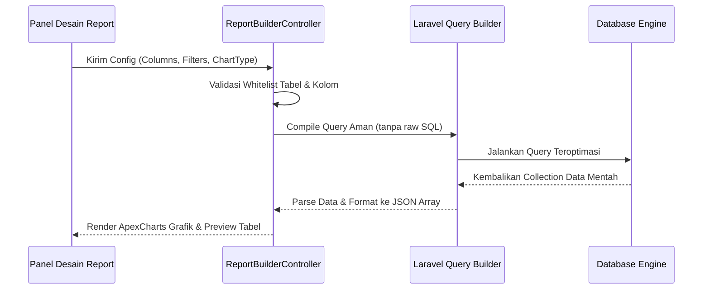

# 📊 Modul Drag-Drop Custom Report Builder SISTA

Modul Custom Report Builder SISTA adalah alat bantu analisis tingkat lanjut (*executive tool*) yang memungkinkan administrator, kepala sekolah, dan bendahara sekolah menyusun laporan ad-hoc secara dinamis, menyajikannya ke dalam grafik interaktif, dan mengekspornya ke berbagai format file.

---

## 📚 1. Komponen Utama & Database Schema

Penyusunan laporan kustom disimpan ke dalam konfigurasi skema dinamis:

### A. Laporan Kustom (`CustomReport`)
*   Menyimpan rancangan laporan yang dibuat oleh pengguna agar dapat dimuat kembali secara instan.
*   `title`: Nama laporan (contoh: "Analisis Tunggakan SPP Kelas XII-A").
*   `created_by`: ID User perancang laporan.
*   `source_table`: Tabel utama data (contoh: `'students'`, `'billings'`, `'grades'`).
*   `selected_columns` (JSON): Kolom-kolom yang ingin disajikan (contoh: `["name", "class", "amount_due"]`).
*   `filters` (JSON): Filter bersyarat (contoh: `[{"column": "status", "operator": "=", "value": "active"}]`).
*   `chart_type`: Jenis grafik bawaan untuk representasi visual (`bar`, `line`, `pie`, `area`, `none`).

---

## ⚙️ 2. Kompilasi SQL Dinamis yang Aman & Visualisasi Grafik

Report Builder memproses parameter front-end menjadi query database secara aman tanpa risiko keamanan:

### A. Fitur Utama Penyusunan Laporan:
1.  **Drag-Drop Field Selector:** Pengguna memilih kolom database apa saja yang ingin ditampilkan dengan drag-and-drop sederhana pada UI, yang terhubung langsung ke state JSON di front-end.
2.  **Secure Query Builder Compiler:** Masukan pengguna dikompilasi secara dinamis menggunakan **Laravel Query Builder** (bukan raw SQL string concatenation). Semua operator dan nama tabel dicocokkan dengan *whitelist* sistem untuk memastikan perlindungan penuh dari **SQL Injection**.
3.  **ApexCharts.js Integration:** Data keluaran dikemas dalam envelope JSON terstruktur dan diparsing otomatis menjadi grafik interaktif ApexCharts (misalnya grafik batang untuk tren bulanan, diagram lingkaran untuk kategori absensi).
4.  **Multi-Format Exporters:** Menyediakan tombol unduh instan ke format **Excel Spreadsheet** dan **PDF Landscape** dengan kop surat instansi resmi, menyesuaikan jumlah kolom secara dinamis agar pas dalam 1 lembar halaman.

---

## 📝 3. Pest Feature Test Scenarios

Keamanan penyusunan query dinamis dan fungsionalitas ekspor dilindungi oleh Pest PHP pada [ReportBuilderTest.php](file:///c:/project/portofolio/project-super-web/sistem-terpadu/tests/Feature/ReportBuilderTest.php):

*   **`pengguna eksekutif dapat menyimpan rancangan laporan kustom`**
    *   Memastikan Kepala Sekolah atau Admin dapat menyimpan konfigurasi kolom dan filter ke tabel `custom_reports`.
*   **`sistem memblokir query jika mencoba mengakses tabel terlarang`**
    *   Mengirimkan request manipulasi tabel internal (seperti `users` atau `login_attempts`) dan memverifikasi sistem menolaknya dengan melempar exception `422 Unprocessable Entity`.
*   **`kompilasi query mengembalikan data yang difilter secara akurat`**
    *   Mencoba filter data siswa dengan status `active` dan memastikan Query Builder hanya memuat entitas dengan kriteria yang sesuai.
*   **`ekspor laporan menghasilkan berkas Excel dan PDF yang valid`**
    *   Memanggil endpoint unduhan ekspor dan menegaskan header respons berisi `content-type` berupa `application/pdf` atau `application/vnd.openxmlformats-officedocument.spreadsheetml.sheet`.
