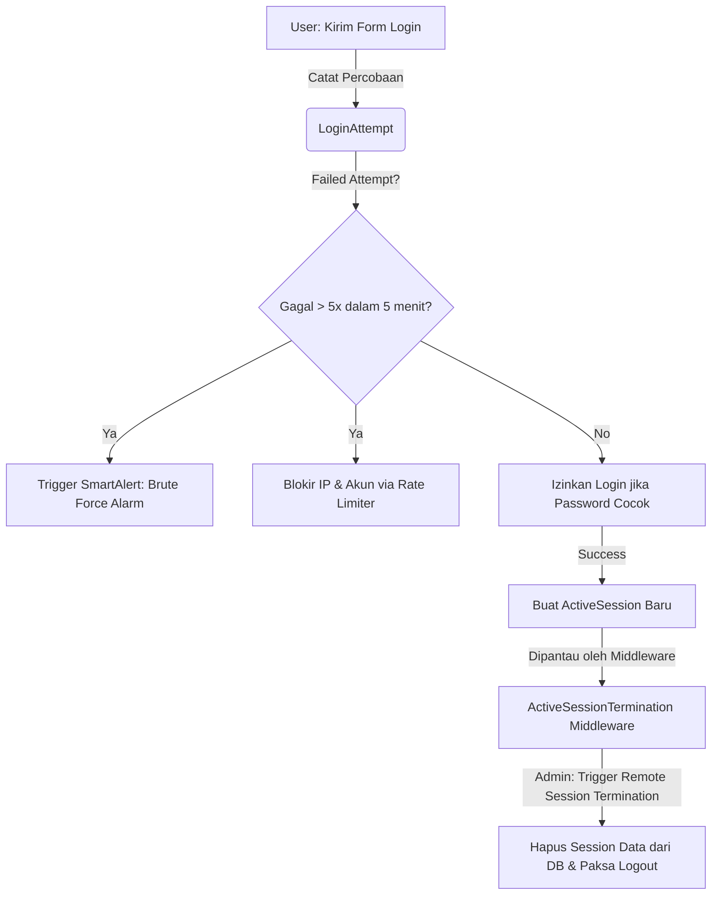

# Modul Monitoring Keamanan SIEM & Sesi Aktif SISTA

Modul Keamanan SISTA bertindak sebagai Security Information and Event Management (SIEM) mini terintegrasi yang memantau keamanan platform dari serangan siber (seperti brute-force), melacak sesi login aktif pengguna, serta memberikan wewenang pemutusan sesi mencurigakan secara paksa (*active session termination*).

---

## 1. Komponen Utama & Database Schema

Keamanan tingkat tinggi ini dikendalikan oleh struktur audit trail real-time:

### A. Audit Trail Login (`LoginAttempt`)
*   Mencatat setiap percobaan masuk ke dalam sistem.
*   `email`: Email yang digunakan untuk mencoba masuk.
*   `ip_address`: Alamat IP klien (IPv4/IPv6).
*   `user_agent`: String identitas browser/sistem operasi penyerang.
*   `status`: Status percobaan (`success`, `failed`).
*   `created_at`: Stempel waktu percobaan (berguna untuk rate limiting).

### B. Manajemen Sesi Aktif (`ActiveSession`)
*   Melacak sesi browser yang sedang login aktif secara real-time.
*   `user_id`: ID pengguna pemilik sesi.
*   `session_id`: ID sesi Laravel terenkripsi.
*   `ip_address`, `user_agent`: Metadata koneksi terakhir.
*   `last_activity`: Unix timestamp penanda keaktifan terakhir pengguna.

---

## 2. Sistem Proteksi SIEM & Pemutus Sesi Paksa

Sistem perlindungan SISTA memantau lalu lintas otentikasi secara dinamis untuk mencegah pengambilalihan akun:

### A. Fitur Deteksi Serangan Brute Force (SIEM):
1.  **SmartAlert Alarms:** Scheduler memindai tabel `login_attempts` setiap 5 menit. Jika terdeteksi adanya IP atau email yang gagal login lebih dari 5 kali berturut-turut, sistem memicu alarm **Brute-Force Attack Alert** di dasbor IT Administrator dan mengirim pesan darurat via WhatsApp.
2.  **IP Rate Limiting:** Menggunakan pembatasan rate limit ketat pada level aplikasi untuk memblokir IP penyerang selama 15 menit jika terindikasi melakukan brute-force login.

### B. Middleware Pemutus Sesi Aktif (*Active Session Termination*):
1.  **Session Auditor Dashboard:** Pengguna (terutama guru dan kepala sekolah) dapat melihat daftar sesi aktif yang sedang menggunakan akun mereka (contoh: Chrome di Windows 11, Safari di iPhone).
2.  **Forced Logout (Remote Kill):** Pengguna dapat mengklik tombol "Akhiri Sesi" pada perangkat lain yang mencurigakan. Middleware SISTA akan mendeteksi pencabutan ID sesi ini pada request berikutnya, langsung menghancurkan token sesi terkait di server, dan mengarahkan paksa (*forced redirection*) browser mencurigakan tersebut ke halaman login seketika.

---

## 3. Pest Feature Test Scenarios

Skenario proteksi login dan manajemen sesi aktif divalidasi penuh oleh suite pengujian otomatis pada [SecurityMonitorTest.php](file:///c:/project/portofolio/project-super-web/sistem-terpadu/tests/Feature/Security/SecurityMonitorTest.php):

*   **`sistem mencatat seluruh log percobaan login`**
    *   Menguji login sukses dan gagal, memastikan masing-masing melahirkan record baru di tabel `login_attempts` dengan status yang sesuai.
*   **`alarm brute-force dipicu jika melampaui batas kegagalan login`**
    *   Mensimulasikan kegagalan login sebanyak 6 kali dalam rentang waktu singkat dan memverifikasi pemicuan event `SmartAlert` dengan kategori keamanan tingkat tinggi (*high priority alert*).
*   **`pengguna dapat melihat daftar perangkat aktif yang sedang login`**
    *   Membuat autentikasi ganda pada sesi simulasi yang berbeda, memverifikasi endpoint daftar sesi mengembalikan persis 2 perangkat aktif.
*   **`pemutusan sesi paksa menghancurkan sesi target secara instan`**
    *   Memicu aksi destroy pada salah satu `session_id` dari `active_sessions` dan memverifikasi request berikutnya menggunakan session ID tersebut ditolak dan diarahkan ke `/login` (302 Redirect).
