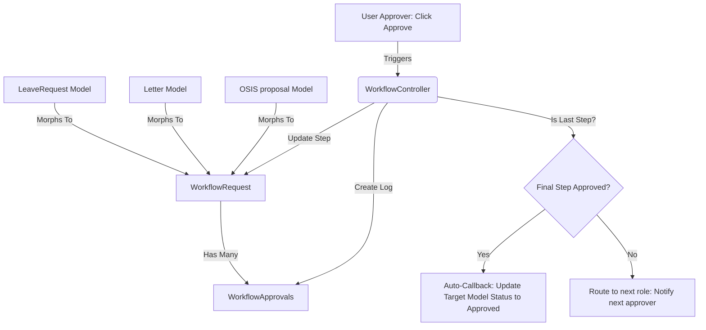

# Modul Polymorphic Approval Workflow Engine SISTA

Workflow Engine SISTA adalah sistem approval dinamis berjenjang berbasis hubungan polimorfik (*polymorphic relationship*) yang memungkinkan dokumen atau pengajuan apa pun (seperti surat digital, pengajuan cuti guru, proposal anggaran OSIS) melewati rantai persetujuan kustom yang ditentukan oleh administrator sekolah.

---

## 1. Komponen Utama & Database Schema

Workflow Engine menggunakan tiga tabel utama untuk mengelola definisi dan eksekusi persetujuan:

### A. Definisi Alur Kerja (`WorkflowDefinition`)
*   Menyimpan konfigurasi alur persetujuan per tipe dokumen.
*   `document_type`: Nama kelas model yang diawasi (contoh: `App\Models\LeaveRequest` atau `App\Models\Letter`).
*   `steps` (JSON): Rantai persetujuan berurutan berdasarkan peran pengguna. Contoh:
    ```json
    [
        {"step": 1, "role": "waka_kurikulum", "label": "Verifikasi Waka Kurikulum"},
        {"step": 2, "role": "kepala_sekolah", "label": "Persetujuan Akhir Kepala Sekolah"}
    ]
    ```

### B. Permohonan Alur Kerja (`WorkflowRequest`)
*   Merupakan pembungkus polimorfik untuk entitas transaksi pengajuan.
*   `requestable_id`, `requestable_type`: Relasi polimorfik (`MorphTo`) ke model target pengajuan.
*   `current_step`: Urutan langkah persetujuan aktif saat ini (integer).
*   `status`: Status global permohonan (`pending`, `approved`, `rejected`).

### C. Keputusan Persetujuan (`WorkflowApproval`)
*   Catatan persetujuan individual per langkah.
*   `workflow_request_id`: Menghubungkan ke record request terkait.
*   `step`: Langkah urutan persetujuan.
*   `user_id`: ID pengguna yang memutuskan.
*   `status`: Status keputusan (`approved`, `rejected`).
*   `notes`: Catatan/alasan persetujuan atau penolakan.

---

## 2. Arsitektur Polimorfik & Rantai Eksekusi

Kemampuan utama dari engine ini terletak pada integrasi polimorfik yang tidak terikat pada struktur data model tunggal:



### A. Dynamic Steps & Visual Steppers:
1.  **Polymorphic MorphTo Mapping:** Memungkinkan model baru dikaitkan dengan sistem approval secara mudah tanpa mengubah struktur tabel database. Cukup implementasikan trait `HasWorkflow` pada model target.
2.  **Visual Workflow Steppers:** Menampilkan progress persetujuan per tahap: centang hijau untuk tahap yang disetujui, indikator oranye untuk tahap aktif, dan abu-abu untuk antrean berikutnya beserta catatan reviewer.
3.  **Final Approval Action Callbacks:** Begitu persetujuan langkah terakhir dicapai, sistem memanggil method callback model target (misal: `onWorkflowCompleted()`). Cuti guru akan otomatis disetujui, sisa kuota cuti dikurangi, atau file PDF surat digital otomatis ditandatangani secara elektronik (*e-signature*).

---

## 3. Pest Feature Test Scenarios

Logika alur persetujuan dijamin oleh suite pengujian unit dan integrasi pada [WorkflowEngineTest.php](file:///c:/project/portofolio/project-super-web/sistem-terpadu/tests/Feature/Workflow/WorkflowEngineTest.php):

*   **`sistem otomatis membuat workflow request saat dokumen diajukan`**
    *   Memastikan pengisian model target (misal: `LeaveRequest`) otomatis membuat record `WorkflowRequest` pendamping berdasarkan config `WorkflowDefinition` yang terdaftar.
*   **`approver dengan role yang salah tidak dapat menyetujui langkah aktif`**
    *   Mencoba menyetujui langkah aktif menggunakan akun guru biasa (peran: `guru`), memverifikasi pelemparan respons status `403 Forbidden`.
*   **`workflow berlanjut ke langkah berikutnya setelah disetujui`**
    *   Menyetujui langkah 1 menggunakan user dengan peran `waka_kurikulum` dan memverifikasi `current_step` bertambah menjadi 2.
*   **`penolakan di salah satu langkah menghentikan dan menolak workflow secara permanen`**
    *   Mensimulasikan keputusan `rejected` pada langkah apa pun. Memverifikasi status global `WorkflowRequest` langsung berubah menjadi `rejected` dan sisa rantai persetujuan ditutup.
*   **`persetujuan akhir memicu callback sukses pada model target`**
    *   Menyetujui seluruh langkah hingga selesai dan memverifikasi kolom `status` pada model asli target (misal: `LeaveRequest`) ikut berubah dari `pending` menjadi `approved`.
