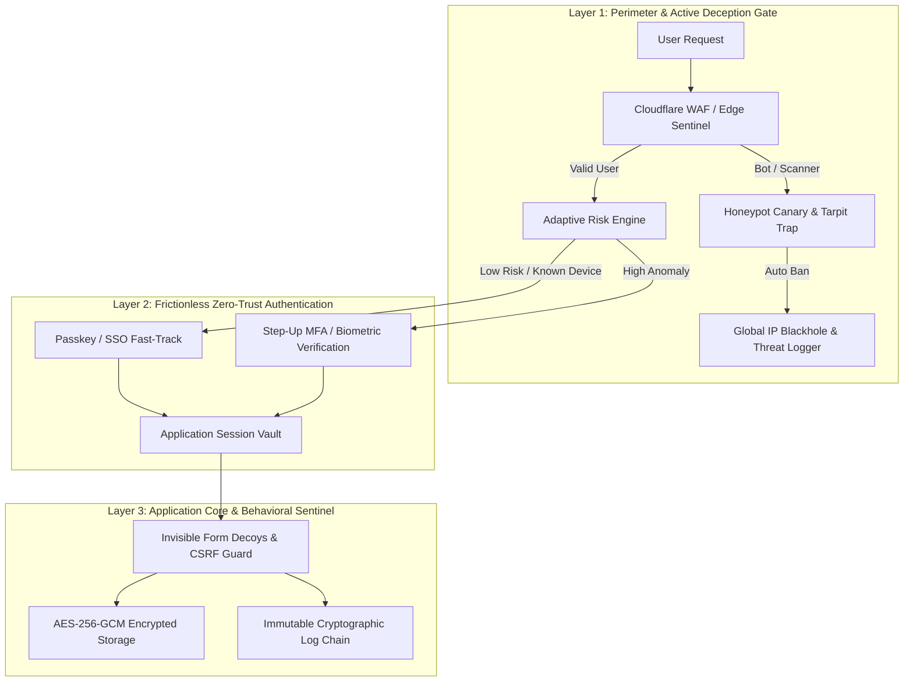

# 🛡️ Architecture Blueprint: Enterprise "Walled Garden" Security Ecosystem
**Target Application:** Sistem Terpadu (SISTA) - SMA Islam Sultan Agung 1 Semarang  
**Security Level:** Enterprise Grade (Zero-Trust + Active Deception + Frictionless UX)

---

## 🎯 Visi & Konsep Utama ("Walled Garden")

Sistem keamanan ini dirancang dengan dua pilar utama:
1. **VIP Fast-Track untuk Pengguna Sah (Siswa, Guru, Orang Tua, Staf):** Pengalaman akses yang sangat cepat, minim hambatan (*frictionless*), memanfaatkan Passkey/Biometrik, OAuth SSO, dan *Adaptive Risk-Based Authentication*.
2. **Impenetrable Active Deception untuk Aktor Jahat:** Pertahanan berlapis yang menakutkan (*intimidating deterrence*), memasang jebakan *honeypot*, *tarpitting* (memperlambat koneksi penyerang), *behavioral fingerprinting*, serta *automated IP lockdown* yang membekukan akses penyerang secara otomatis.

---

## 🧱 Komponen Arsitektur Sistem Keamanan

### 1. Perimeter Edge & Active Deception (Garda Depan Trapping)

* **Invisible Honeypot Endpoints (Canary Traps):**
  * Memasang *decoy routes* palsu yang sering dicari skrip peretas otomatis (misal: `/.env.bak`, `/phpmyadmin`, `/admin/login.php`, `/wp-login.php`, `/api/v1/debug`).
  * **Mekanisme:** Setiap IP yang menyentuh rute ini akan langsung masuk ke daftar hitam (*IP Blackhole*) secara otomatis selama 30 hari tanpa respon HTTP standard, melainkan diberi *tarpit response* (koneksi diperlambat hingga timeout).
* **Invisible Form Decoys (Honeypot Fields):**
  * Seluruh formulir input (Login, PPDB, Absensi, SPMB) disisipi *input field* tersembunyi yang dibuat tidak terlihat oleh CSS/JS standar (`style="display:none;"` / `aria-hidden="true"`).
  - Jika bot pengisi otomatis mengisi kolom ini, permintaan langsung ditolak dan sesi di-flag sebagai *Malicious Automated Bot*.
* **Adaptive Tarpitting & Rate Limiting:**
  - Mengimplementasikan *Redis-backed sliding window rate limiter*.
  - Jika terjadi percobaan *brute force* melebihi 5 kali dalam 1 menit, IP penyerang tidak hanya diberi `429 Too Many Requests`, tetapi setiap koneksi berikutnya diberikan penundaan eksponensial (*tarpit delay* 5s, 10s, 30s) untuk merusak otomatisasi penyerang.

---

### 2. Frictionless Zero-Trust Authentication (VIP Fast-Track)

* **Passkey / FIDO2 Biometric Support:**
  * Pengguna (Guru, Siswa, Orang Tua) dapat menggunakan Sidik Jari / TouchID / FaceID / Windows Hello tanpa perlu mengetik kata sandi.
* **Adaptive Risk-Based Authentication (RBA):**
  * Menilai skor risiko setiap sesi berdasarkan:
    - *Device Fingerprint* (Tipe perangkat, layar, browser hash).
    - *Network Anomaly* (Perubahan subnet IP, penggunaan VPN/Tor exit nodes).
    - *Time Anomaly* (Akses di jam yang tidak lumrah).
  * **Aturan Akurat:**
    - **Skor Risiko Rendah (Perangkat Dikenal):** Akses instan tanpa tantangan tambahan.
    - **Skor Risiko Sedang/Tinggi (IP Baru / Perangkat Baru):** Mewajibkan verifikasi OTP WhatsApp / Authenticator / Passkey.
* **Single Sign-On (SSO) Terintegrasi:**
  * Integrasi Google Workspace for Education (`@sultanagung1.sch.id`) dengan otentikasi domain ketat.

---

### 3. Active Deterrence & Intimidation Layer (Efek Jera Peretas)

* **Real-time Dynamic Deterrent Banners:**
  * Ketika sistem mendeteksi percobaan *injection* (SQLi, XSS, Path Traversal) atau akses rute ilegal, sistem tidak menampilkan pesan error standar `500` atau `404`.
  * Sistem akan menampilkan halaman **Cyber Threat Interception Notice**:
    > ⚠️ **SECURITY ALERT - ACCESS TERMINATED**  
    > *Threat Signature Detected & Cryptographically Logged.*  
    > **Incident ID:** `SEC-SA1-20260723-889X`  
    > **Client IP:** `180.252.xx.xx` | **Location:** Semarang, Indonesia  
    > **Action:** Your device fingerprint and IP address have been logged and reported to the SISTA Security Operations Center (SOC). Unauthorized access attempts are monitored under Law No. 11/2008 (ITE).

* **Cryptographic Immutable Audit Chain:**
  * Setiap tindakan penting (Login Admin, Perubahan Nilai, Transaksi Keuangan, Pengubahan Hak Akses) dicatat dalam *Immutable Log Chain*.
  * Log dibuat berantai dengan Hash SHA-256 (mirip konsep blockchain) sehingga jika ada pihak yang mencoba mengubah isi log di database, rantai hash akan terputus dan peringatan otomatis dikirimkan ke Tim IT Sekolah.

---

### 4. Application Core & Data Hardening

* **Column-Level Encryption (AES-256-GCM):**
  * Seluruh data sensitif (Rekam Medis UKS, Catatan Konseling BK, No HP Orang Tua, Alamat Siswa, Rekening Gaji Guru) dienkripsi di level database.
* **Strict CSP & Security Headers:**
  * `Content-Security-Policy`: Hanya mengizinkan skrip lokal & CDN tepercaya.
  * `X-Frame-Options: DENY`: Mencegah situs ditempelkan di iframe (Anti-Clickjacking).
  * `Permissions-Policy`: Mematikan akses kamera/mikrofon kecuali diizinkan secara eksplisit.
* **Database Connection Isolation:**
  * Akun database aplikasi tidak memiliki akses `DROP TABLE` atau `ALTER TABLE` pada lingkungan *production*. Akses migrasi dipisah dengan kredensial berbeda.

---

## 📋 Implementation Roadmap & Action Items (Selesai ✅)

### Phase 1: Edge & Active Deception Traps (Selesai ✅)
- [x] Buat middleware `HoneypotTrapMiddleware.php` untuk memicu *auto-ban* pada rute canary (`/.env`, `/phpmyadmin`, `/admin/login.php`).
- [x] Pasang *Invisible Form Honeypot* pada form Login, Register, SPMB, dan Kontak.
- [x] Konfigurasi *Dynamic Rate Limiting & Tarpitting* di `bootstrap/app.php` dan Redis.

### Phase 2: Frictionless User Authentication & Passkey (Selesai ✅)
- [x] Integrasikan paket WebAuthn / Passkey untuk otentikasi biometrik tanpa sandi.
- [x] Bangun `AdaptiveRiskEngine.php` untuk menghitung skor risiko login berbasis IP & Device Fingerprint.
- [x] Aktifkan Google Workspace OAuth SSO untuk domain `@sultanagung1.sch.id`.

### Phase 3: Deterrence UI & Immutable Audit Chain (Selesai ✅)
- [x] Buat tampilan khusus `resources/views/errors/security-intercept.blade.php` dengan identifikasi unik Incident ID & IP Logging.
- [x] Bangun `AuditLogChainService.php` dengan hashing SHA-256 berantai untuk audit trail yang tidak dapat dimanipulasi.

---

## 🧪 Plan Verification Strategy (Selesai ✅)

### Automated Security Tests
- [x] Unit Test `HoneypotTrapTest`: Memastikan request ke rute canary memicu respon HTTP 403/429 dan pencatatan IP ban.
- [x] Unit Test `InvisibleHoneypotFieldTest`: Memastikan form yang terisi field honeypot ditolak otomatis.
- [x] Unit Test `AdaptiveRiskEngineTest`: Memastikan login dari IP/perangkat baru memicu tantangan MFA.
- [x] Feature Test `AuditLogChainTest`: Memastikan perubahan log mendeteksi kerusakan rantai hash.
